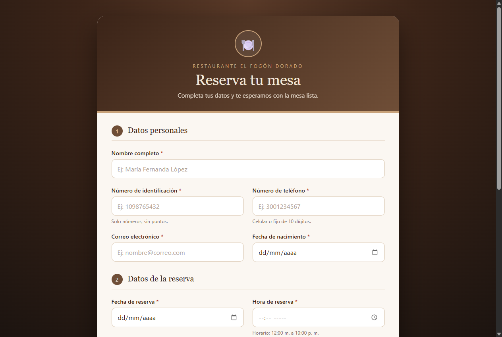
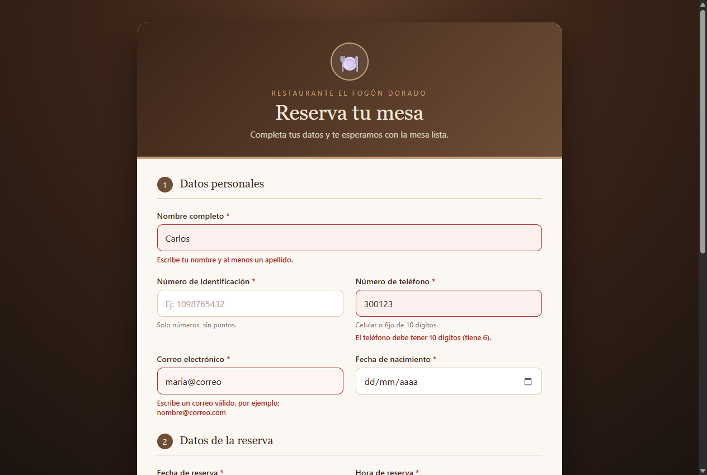
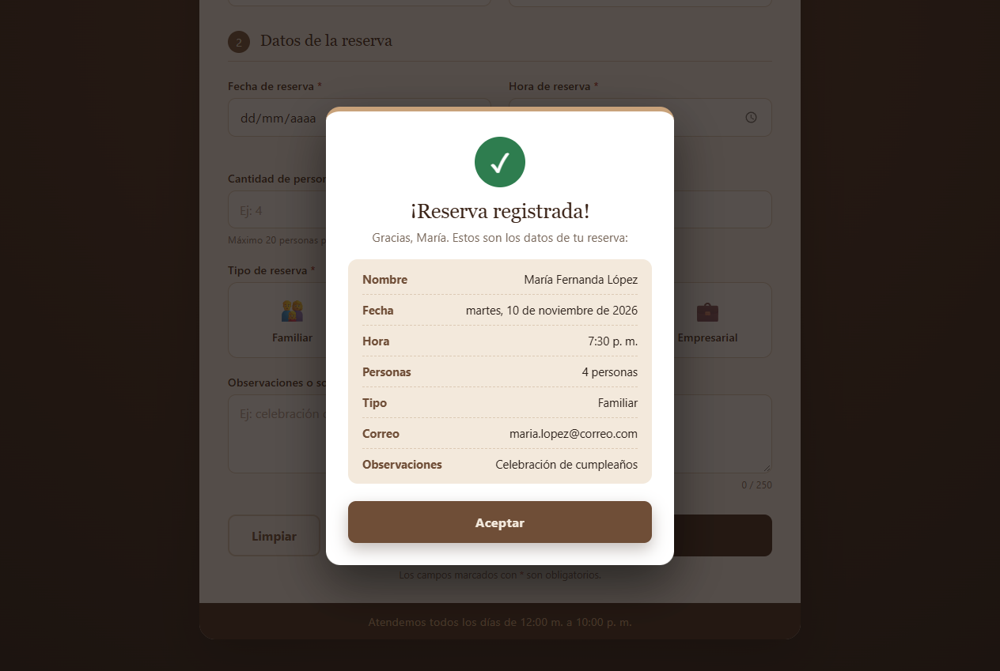
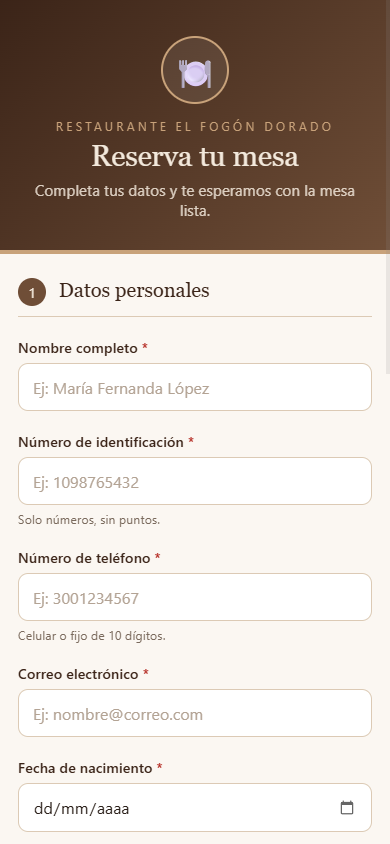
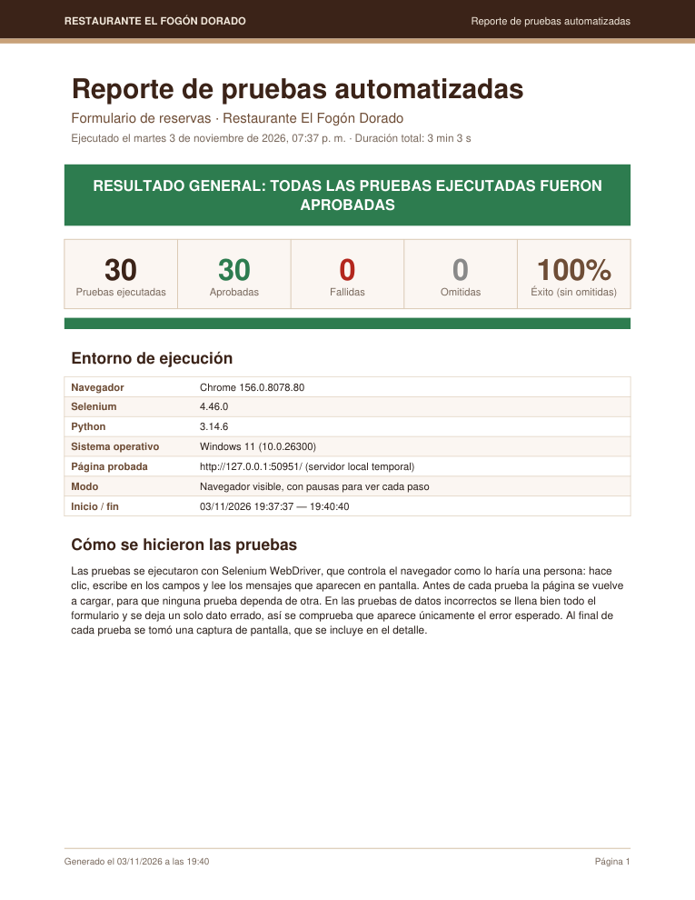

# Formulario de reservas — Restaurante El Fogón Dorado

Formulario web para registrar personas que quieren reservar una mesa en un restaurante.
Está hecho solo con **HTML5, CSS3 y JavaScript**, sin frameworks ni librerías, e incluye
**30 pruebas automáticas con Selenium** que generan un **reporte en PDF**.



---

## Contenido

1. [Características](#características)
2. [Estructura del proyecto](#estructura-del-proyecto)
3. [Cómo abrir el proyecto](#cómo-abrir-el-proyecto)
4. [Cómo funciona cada archivo](#cómo-funciona-cada-archivo)
5. [Pruebas automáticas con Selenium](#pruebas-automáticas-con-selenium)
6. [Personalizar el proyecto](#personalizar-el-proyecto)
7. [Solución de problemas](#solución-de-problemas)

---

## Características

- Diseño moderno con colores de restaurante (café, beige, blanco y negro).
- Formulario centrado y **adaptable**: 2 columnas en computador y 1 en celular.
- 10 campos: nombre, identificación, teléfono, correo, fecha de nacimiento, fecha y hora de
  la reserva, cantidad de personas, tipo de reserva y observaciones.
- Validaciones con mensajes de error debajo de cada campo, en rojo.
- Los errores se revisan al salir de cada campo y desaparecen apenas se corrige el dato.
- Ventana de confirmación con el resumen de la reserva.
- El formulario se limpia solo después de registrar.

| Errores de validación | Confirmación | Celular |
|---|---|---|
|  |  |  |

---

## Estructura del proyecto

```
formulario-restaurante/
├── index.html                  Estructura de la página (HTML5)
├── css/
│   └── styles.css              Diseño, colores y versión para celular (CSS3)
├── js/
│   └── script.js               Validaciones y ventana de confirmación (JavaScript)
├── img/
│   └── logo-ing-carlos.webp    Logo de los créditos del pie de página
├── iniciar.bat                 Abre el proyecto en el navegador con un servidor local
├── ejecutar_pruebas.bat        Ejecuta las pruebas automáticas y genera el PDF
├── pruebas/
│   ├── pruebas_formulario.py   Las 30 pruebas con Selenium
│   ├── reporte_pdf.py          Arma el reporte PDF (ReportLab)
│   ├── requirements.txt        Librerías de Python que necesitan las pruebas
│   └── reportes/               PDF y capturas de cada ejecución (se crea solo)
├── docs/
│   └── capturas/               Imágenes que usa este README
├── .gitignore
└── README.md
```

---

## Cómo abrir el proyecto

### Opción 1: con `iniciar.bat` (recomendada)

Doble clic en **`iniciar.bat`**. Este archivo:

1. Inicia un servidor web local con Python en una ventana **minimizada** llamada
   "Servidor Restaurante".
2. Abre el navegador en **http://localhost:8085/**.

Si lo ejecutas de nuevo y el servidor ya está encendido, solo abre el navegador.
Para **apagar** el servidor, cierra la ventana minimizada "Servidor Restaurante" de la barra de tareas.

> Si el computador no tiene Python, `iniciar.bat` abre `index.html` directamente.

### Opción 2: sin servidor

Doble clic en **`index.html`**. Como el proyecto no usa librerías externas, funciona igual
abriéndolo directamente en Chrome, Edge o Firefox.

---

## Cómo funciona cada archivo

### `index.html` — la estructura

- El encabezado muestra el nombre del restaurante.
- El formulario tiene dos secciones (`<fieldset>`): **Datos personales** y **Datos de la reserva**.
- Cada campo está dentro de un `<div class="grupo">` con su `<label>`, el campo y un
  `<small id="error-...">` donde aparece el mensaje de error.
- El tipo de reserva son 4 botones de opción (`radio`) con forma de tarjeta.
- El formulario lleva `novalidate`, así los mensajes los controla el JavaScript y no el navegador.
- La ventana de confirmación empieza oculta (`hidden`).
- Debajo de la tarjeta, el `<footer class="creditos">` muestra el logo y "Hecho por el Ing. Carlos".

### `css/styles.css` — el diseño

- Los colores se definen una sola vez como **variables** en `:root` (`--cafe`, `--beige`, etc.).
- La tarjeta se centra en la pantalla con **flexbox** y los campos van en una **cuadrícula** de 2 columnas (`grid`).
- Las clases `.invalido` y `.valido`, que agrega el JavaScript, pintan el campo de rojo o de verde.
- Con `@media (max-width: 640px)` todo pasa a una columna en el celular.

### `js/script.js` — las validaciones

El archivo está dividido en 10 bloques comentados. Cada campo tiene su propia función
(`validarNombre()`, `validarTelefono()`...) que devuelve `true` si el dato está bien o `false` si tiene error.

| Campo | Regla |
|---|---|
| Nombre | Obligatorio, solo letras y espacios, con nombre y al menos un apellido |
| Identificación | Obligatorio, solo números, entre 6 y 10 dígitos |
| Teléfono | Obligatorio, 10 dígitos; empieza por 3 (celular) o por 60 (fijo). Se aceptan espacios |
| Correo | Obligatorio, formato `nombre@dominio.com` |
| Fecha de nacimiento | Obligatoria, no puede ser futura y la persona debe tener 18 años o más |
| Fecha de reserva | Obligatoria, no puede ser anterior a hoy |
| Hora de reserva | Obligatoria, entre 12:00 m. y 10:00 p. m.; si la reserva es para hoy, debe ser una hora que no haya pasado |
| Cantidad de personas | Obligatoria, número entero entre 1 y 20 |
| Tipo de reserva | Obligatorio: familiar, pareja, amigos o empresarial |
| Observaciones | Opcional, máximo 250 caracteres (con contador) |

Al presionar **Confirmar reserva**:

1. Se ejecutan todas las validaciones, para mostrar todos los errores a la vez.
2. Si hay errores, aparece el aviso general y el cursor va al primer campo con error.
3. Si todo está bien, se arma el resumen y se muestra la ventana de confirmación. El resumen se
   escribe con `textContent`, no con `innerHTML`, para que lo que escribe el usuario nunca se
   interprete como código HTML.
4. Los datos se muestran en la consola del navegador (tecla **F12**) y el formulario se limpia.

> El proyecto no guarda las reservas en ninguna parte. En un sistema real, en el paso 4 los datos se enviarían a un servidor.

---

## Pruebas automáticas con Selenium

### Requisitos

- **Python 3.8 o superior** (en Windows se usa el comando `py`).
- **Google Chrome**. Si no está instalado, las pruebas intentan con Microsoft Edge.
- **Internet la primera vez**, para instalar las librerías y para que Selenium descargue el driver del navegador.

### Cómo ejecutarlas

Doble clic en **`ejecutar_pruebas.bat`**. Este archivo:

1. Busca Python e instala **Selenium** y **ReportLab** si faltan (`pruebas/requirements.txt`).
2. Abre Chrome y ejecuta las pruebas **a la vista**:
   - Arriba a la izquierda aparece un cartel con la prueba en curso
     ("Prueba 5 de 30…"). Al terminar cada una se pone **verde** si pasó o **rojo** si falló.
   - Escribe letra por letra, y el campo donde está trabajando se marca con un borde naranja.
3. Al final muestra un resumen en el navegador, lo cierra, genera el **reporte PDF** y lo abre.

La ejecución completa dura unos **3 minutos**. Las pruebas levantan su propio servidor
temporal, así que no hace falta tener abierto `iniciar.bat`.

Desde una consola, en la carpeta del proyecto, se pueden usar estas opciones:

```bash
ejecutar_pruebas.bat --rapido
```

```bash
ejecutar_pruebas.bat --oculto
```

- `--rapido`: sin pausas (dura unos 2 minutos, pero es difícil seguirlo con la vista).
- `--oculto`: sin mostrar el navegador.

> No cierres la ventana de Chrome mientras corren las pruebas. Si se cierra, las pruebas se
> detienen y el PDF sale marcado como **"ejecución incompleta"**.

### Qué se prueba (30 pruebas)

| Grupo | Pruebas |
|---|---|
| Carga | La página, los estilos y el script cargan; 2 columnas en computador |
| Campos vacíos | Enviar vacío muestra los 9 mensajes de obligatorio, el aviso general y el cursor en Nombre |
| Datos incorrectos (16) | Nombre sin apellido o con números; identificación con puntos o muy corta; teléfono incompleto, con letras o que no es colombiano; correo sin dominio o sin @; menor de edad; nacimiento futuro; reserva en fecha pasada; hora antes de abrir o después de cerrar; más de 20 o cero personas |
| Hora del día | Reserva para hoy con una hora que ya pasó* |
| Comportamiento | Teléfono con espacios aceptado; el error desaparece al corregir; selección del tipo de reserva; contador de caracteres; límite de 250 caracteres |
| Registro | Registro exitoso con resumen correcto; el formulario se limpia; la confirmación se cierra con Esc; botón Limpiar |
| Seguridad | El código HTML escrito en Observaciones se muestra como texto y no se ejecuta |
| Celular | En 375 px los campos pasan a 1 columna, los tipos de reserva a 2 y los botones se apilan |

En las pruebas de datos incorrectos se llena **bien** todo el formulario y se deja **un solo dato errado**.
Así se comprueba que aparece únicamente el error esperado y que la reserva no se registra.

\* Esta prueba solo se puede hacer entre las 12:05 p. m. y las 10:05 p. m. Fuera de ese horario
aparece como **OMITIDA** (no cuenta como fallida).

### El reporte PDF

Se guarda en `pruebas/reportes/reporte_pruebas_AAAA-MM-DD_HH-MM-SS.pdf` y tiene:

- **Portada**: resultado general (franja verde o roja), totales, porcentaje de éxito y datos
  del entorno (navegador, versiones de Selenium y Python, sistema y duración).
- **Tabla resumen** con las 30 pruebas, su resultado y su tiempo.
- **Detalle de cada prueba**: qué se esperaba, qué se obtuvo y la captura de pantalla.



Las capturas de cada ejecución quedan en `pruebas/reportes/capturas_<fecha>/`. Esa carpeta
puede borrarse cuando quieras: se vuelve a crear en la siguiente ejecución.

---

## Personalizar el proyecto

- **Colores**: se cambian en las variables al inicio de `css/styles.css` (bloque 1).
- **Reglas del restaurante** (horario, máximo de personas, edad mínima): están en las
  constantes al inicio de `js/script.js` (bloque 2). Ojo: los textos de los mensajes que
  aparecen en pantalla están escritos aparte en cada función de validación.
- **Pruebas**: si cambias una regla o un mensaje, actualiza también la tabla
  `CASOS_DE_ERROR` de `pruebas/pruebas_formulario.py`. Para agregar un caso de dato incorrecto
  basta con agregar una línea a esa tabla.
- **Velocidad de las pruebas**: `PAUSA` y `VELOCIDAD_TECLEO`, al inicio de `pruebas/pruebas_formulario.py`.

---

## Solución de problemas

| Problema | Solución |
|---|---|
| `iniciar.bat` abre el navegador pero la página no carga | Otro programa usa el puerto 8085. Cambia `set PUERTO=8085` en `iniciar.bat` por otro número, por ejemplo 8090 |
| "No se encontró Python" | Instala Python desde [python.org](https://www.python.org) y marca la opción *Add Python to PATH* |
| "No se pudo abrir Chrome ni Edge" | Instala Google Chrome y, la primera vez, ejecuta las pruebas con internet |
| El PDF dice "ejecución incompleta" | Se cerró la ventana de Chrome durante las pruebas; vuelve a ejecutarlas sin cerrarla |
| Una prueba sale OMITIDA | Es la prueba de la hora del día; se ejecuta entre las 12:05 p. m. y las 10:05 p. m. |

---

## Tecnologías

- **Página**: HTML5, CSS3 (variables, flexbox, grid, media queries) y JavaScript, sin librerías.
- **Pruebas**: Python, Selenium WebDriver y ReportLab para el PDF.
